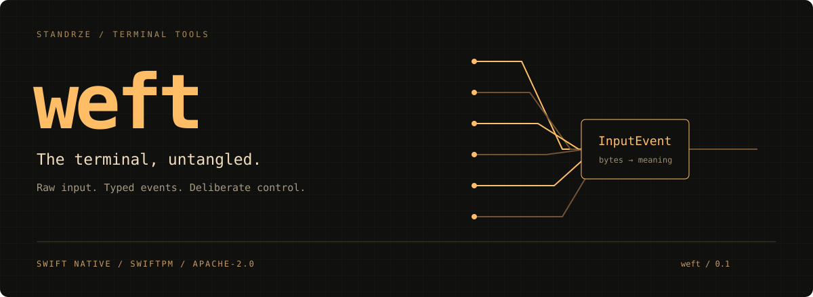

[](https://www.swift.org/)
[](Package.swift)
[](LICENSE)

**Swift terminal infrastructure with explicit ownership.** Open a session, decode
input into typed events, and restore the terminal when you finish. Use it alone
or underneath [loom](https://github.com/standrze/loom).

## From byte stream to keystroke

| Layer | What you get |
| --- | --- |
| Sessions | Raw mode, alternate screen, mouse policies, shell suspension, terminal handoff |
| Input | Incremental UTF-8, escape sequences, bracketed paste, mouse buttons and modifiers |
| Keyboard | Legacy keys and opt-in Kitty keyboard protocol support |
| Events | Asynchronous input, resize, query results, and resume delivery through `TerminalEvents` |
| Output | A small `Backend` protocol, ANSI output, terminal commands |
| Geometry | Cell widths, points, rectangles, terminal capability detection |

Rendering is optional. There is no dependency on loom or an application framework.

## Add it with SwiftPM

Requires **Swift 6.4+**. The package declares **macOS 13+** and includes Linux
terminal code. Version `0.2.0` adds PTY processes, terminal handoff, query routing and shell job
control. Release validation on macOS includes tests and PTY smoke checks; Linux
validation runs in CI. This release uses `requestQuery(.cursorPosition)` and
`InputEvent.queryResult` in place of the cursor-specific API from `0.1.2`.

Add the package dependency:

```swift
.package(url: "https://github.com/standrze/weft.git", from: "0.2.0")
```

Then add its product to your target's dependencies:

```swift
.product(name: "weft", package: "weft")
```

The module name is lowercase: `import weft`.

## Decode without opening a terminal

```swift
import weft

var decoder = InputDecoder()
let events = decoder.feed(Array("\u{1b}[A".utf8))
assert(events == [.key(.up)])
```

The decoder retains partial sequences between calls. A standalone Escape byte
needs a timeout decision from its caller; call `flushEscape()` once that timeout
expires. `TerminalSession` handles this for interactive use.

## Relay undecoded terminal input

`TerminalSession.pollBytes(timeoutMilliseconds:)` returns `TerminalByteEvent`
values: original input bytes, resize events, signals, or terminal resume notifications. It does not
decode or normalize Escape, bracketed paste, Kitty keys, or partial UTF-8. Empty
polls do not flush a pending Escape. `writeBytes(_:)` sends output unchanged.

A session selects byte or decoded input on its first poll. Mixing `pollBytes`
and `poll` throws `TerminalError.inputModeConflict`, preserving the first mode's
buffered input. Use one serial execution context, as with decoded sessions.
Raw output callers own the protocols they emit and must balance their modes;
`PseudoTerminalProcess` provides a separate child PTY when a relay needs one.
For a child that inherits the user's terminal, use `withSuspendedTerminal(_:)`.

## Try a live session

```sh
swift run weft-demo
```

The example opens an alternate screen and prints typed input events. Press
**Escape** or **Ctrl-C** to exit. It uses `TerminalEvents` on the main actor and
stops the event source before closing its session.

Try `swift run weft-demo --features` for terminal queries, mouse capture, and
light/dark notifications. **Ctrl-E** runs a child with normal terminal settings;
**Ctrl-Z** returns to your shell and `fg` resumes the demo.

See [terminal integration](Documentation/TerminalIntegration.md),
[the example](Examples/Demo/Demo.swift), and [session ownership](Documentation/Architecture.md).

## Development

```sh
scripts/check-format.sh
swift test
swift build --product weft-demo
python3 scripts/smoke.py .build/debug/weft-demo
python3 scripts/smoke-features.py .build/debug/weft-demo
python3 scripts/smoke-job-control.py .build/debug/weft-demo
```

See [CONTRIBUTING.md](CONTRIBUTING.md). Version `0.1.0` is an early extraction
from ono-sendai; APIs may change before 1.0. Terminal behavior and character widths
vary between emulators and fonts.

## License

[Apache License 2.0](LICENSE). Dependencies retain their own licenses.
The banner is an original SVG included in this repository under the same license.


Terminal focus reporting is opt-in through `TerminalOptions(focusReporting: true)`.
The session enables DEC private mode 1004 on entry and disables it on close,
including initialization-failure cleanup. Exact `CSI I` and `CSI O` reports
produce `InputEvent.focusChanged(true)` and `.focusChanged(false)`; fragmented
input is retained, while bracketed paste stays literal. Application policies
such as return-from-away recaps belong to the host. Terminals that do not support
focus reports may never deliver those events. The demo and PTY smoke exercise
focus gain/loss alongside terminal restoration.

Keypad digits and operators decode as text, and keypad Enter/navigation keys use
their ordinary `Key` identities. Kitty input retains modifiers, phases, alternate
keys, and associated text; legacy application-keypad SS3 sequences are also supported.
The keypad center key is `Key.begin`.
Kitty keypad encodings follow the [functional key definitions](https://sw.kovidgoyal.net/kitty/keyboard-protocol/#functional-key-definitions).

Bracketed pastes within `maximumPasteBytes` produce `.paste(text)`. An oversized
paste produces `.pasteTruncated(prefix)` instead, so applications can report the
loss before using the text. The decoder consumes through the terminator, preserves
following input, and drops an incomplete trailing UTF-8 scalar at the byte limit.
An empty paste remains `.paste("")`, including with a zero-byte budget.
Applications with exhaustive switches must handle the new `.pasteTruncated` and
`Key.begin` cases.

`TerminalOptions(escapeTimeoutMilliseconds: 150)` allows a longer delay for legacy
Escape prefixes over remote links. Polling and `TerminalEvents` share this setting
(35 ms by default); an indefinite poll is bounded by a pending Escape deadline.
Zero resolves a lone Escape immediately and therefore cannot await fragmented
Alt/key sequences. Raw-byte polling has no Escape timeout. Try the async demo with
`swift run weft-demo --escape-timeout-ms 150`.

[Linux CI](.github/workflows/ci.yml) uses Swift 6.4 to check formatting, run the full
test suite (including real child PTYs), and smoke-test input, queries, handoff,
shell job control, and default/extended Escape delays. Hosted CI results apply
after these changes are published.
